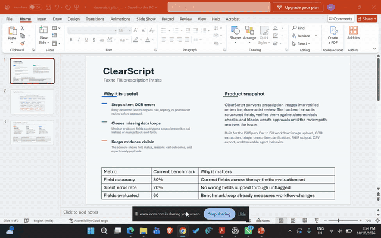
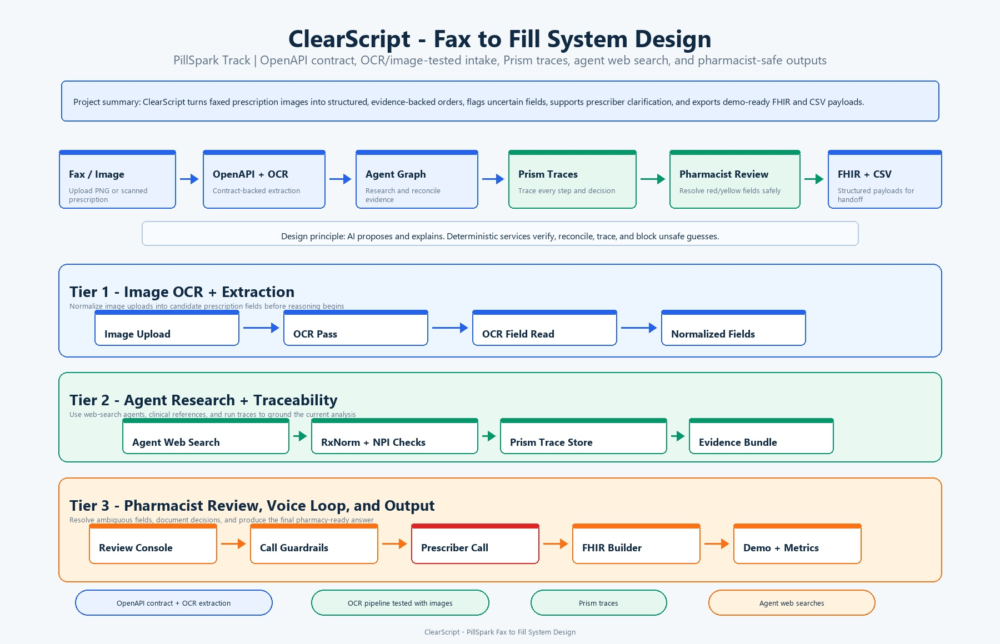

# ClearScript - Fax to Fill (Winner of Columbia Get Hired Hack 2026)

ClearScript turns messy faxed prescription images into pharmacist-reviewable, evidence-backed orders instead of asking pharmacy teams to trust raw OCR. When fields are missing or risky, the workflow can route to an ElevenLabs voice agent to call the prescriber, use Tavily for web search and public validation, and capture Prism traces so every agent action, link, decision, and model behavior is explainable.

The product hook is simple: fax intake is still slow, manual, and error-prone, but prescriptions cannot tolerate silent guesses. ClearScript reads the image, verifies the claim, flags uncertainty, shows the evidence, and only lets safe orders move forward.

## Demo and Slides

[](deliverables/clearscript_demo.mp4)

[Watch the full demo on Loom](https://www.loom.com/share/fca260457bca494b9aa7068cfd4a0422)

[Open the pitch slides](deliverables/clearscript_pitch_deck.pptx)



ClearScript is designed around a simple flow: the pharmacist uploads a fax image, the backend extracts candidate prescription fields, deterministic verification assigns field-level risk, Tavily can ground uncertain values with public context, Prism records the model/tool behavior, the pharmacist resolves anything unsafe, and the approved order exports as FHIR or CSV.

## What This Repo Contains

This repository includes the complete hackathon demo path:

- A FastAPI backend for upload, order review, call decisions, approval, metrics, FHIR, and CSV export.
- A Next.js pharmacist console for queue review, evidence inspection, field resolution, call handling, and approval.
- An image extraction workflow using an OpenAI-compatible Nicrron API and OCR/image processing.
- Deterministic verification and triage rules for prescription fields.
- Tavily-backed web validation and Prism-traced agent/tool behavior.
- Sample prescription images, sample outputs, API contracts, benchmark data, a demo video, and pitch slides.

## Why It Is Better

| Dimension | Naive fax OCR | ClearScript |
| --- | --- | --- |
| Missing data | Leaves gaps or forces manual re-entry | Escalates missing/high-risk fields into pharmacist review and prescriber-call flow |
| Validation | Extracted text is treated as truth | RxNorm, NPI, DEA, sig, date, and rule checks verify values before approval |
| External grounding | No public-source validation | Tavily web search supports prescriber/contact and safety validation |
| Explainability | Hard to know why a field was accepted | Prism traces capture model calls, agents, evidence, and decisions |
| Review workflow | Raw document plus manual judgment | Queue, triage badges, evidence drawer, resolve actions, call transcript, audit trail |
| Output | Unstructured text | FHIR bundle and CSV export after approval |

## Current Metrics

The included benchmark runner compares generated prescription orders against truth files. Current local benchmark output:

| Metric | Current value | What it means |
| --- | ---: | --- |
| Field accuracy | 81% | Correct fields over the synthetic benchmark set |
| Silent error rate | 19% | Wrong fields that slipped through unflagged |
| Flag precision | 92% | Flagged fields are meaningful in the current benchmark |
| Total fields evaluated | 60 | Number of compared prescription fields |
| Mismatches | 0 | No field-level mismatches in the current generated benchmark |

These are development metrics on synthetic/sample data, not production clinical claims. The point is that the repo already has an evaluation loop, so new extraction or validation changes can be measured instead of guessed.

## Product Workflow

| Step | System behavior | Primary implementation |
| --- | --- | --- |
| 1. Upload fax/image | Pharmacist uploads a PNG/JPEG prescription image | `POST /faxes` in `clearscript/api/main.py` |
| 2. Extract fields | OCR/image extraction reads patient, medication, sig, prescriber, and date fields | `process_images/process_image.py` |
| 3. Normalize and verify | Values are checked against deterministic rules and registries | `clearscript/pipeline/verify/rules.py` |
| 4. Triage | Each field becomes green, yellow, or red based on validation severity | `clearscript/pipeline/triage/scorer.py` |
| 5. Ground with web search | Tavily supports public validation and safety/contact lookup | `clearscript/integrations/tavily.py` |
| 6. Review | Pharmacist reviews evidence, resolves ambiguous fields, or starts a call | `web/components/order/OrderReview.tsx` |
| 7. Call prescriber | Missing/uncertain data can be confirmed through the voice-call workflow | `services/calls/` and call endpoints |
| 8. Export | Approved orders produce FHIR and CSV outputs | `/orders/{id}/fhir`, `/orders/{id}/export.csv` |

## System Architecture

ClearScript is built as a contract-first workflow:

| Layer | Responsibility |
| --- | --- |
| Web console | Review queue, upload dialog, field evidence, call panel, approve/reject flow, metrics |
| FastAPI backend | API contract, upload orchestration, order state, call simulation/provider boundary, FHIR/CSV output |
| Extraction workflow | OpenAI-compatible Nicrron API reads prescription images into a strict schema |
| Verification engine | Rule, registry, and safety checks decide what can be trusted |
| Agent/web validation | Tavily-powered public search supports validation and callback research |
| Observability | Prism traces model and agent behavior for explainability |
| Evaluation | Benchmark generator/runner measures accuracy and silent-error behavior |

## Tech Stack

- **Frontend:** Next.js, React, TypeScript, mock service worker, Playwright tests.
- **Backend:** FastAPI, Python, Pydantic-style contracts, in-memory demo state.
- **Extraction:** Nicrron OpenAI-compatible vision endpoint plus local image-processing helpers.
- **Validation:** RxNorm/NPI-style integrations, deterministic prescription rules, triage scoring.
- **Search and grounding:** Tavily for public web validation and supporting evidence.
- **Voice workflow:** ElevenLabs-ready prescriber clarification flow, simulated by default for local demos.
- **Observability:** Prism tracing for model, tool, and agent behavior.
- **Outputs:** FHIR bundle and CSV export contracts.

## Repository Layout

```text
.
├── artifacts/
│   └── clearscript_system_design.jpg
├── clearscript/
│   ├── api/                 # FastAPI app and workflow adapter
│   ├── benchmark/           # Synthetic benchmark generator/runner
│   ├── core/                # Shared backend domain schemas
│   ├── integrations/        # Nicrron, RxNorm, NPI, Tavily
│   └── pipeline/            # Extraction, verification, triage
├── contracts/               # OpenAPI, websocket schema, demo fixtures
├── deliverables/             # Demo video, GIF preview, pitch deck
├── sample_data/              # Sample prescription images
├── sample_output/            # Sample extraction/output JSON
├── process_images/          # Image-to-prescription extraction
├── services/calls/          # Prescriber-call state/contracts
├── web/                     # Next.js pharmacist console
├── scripts/                 # Contract checks, health checks, diagram renderer
└── tests/                   # Backend/unit tests
```

## Implementation Notes

### Backend

The backend is a FastAPI app in `clearscript/api/main.py`. It serves the same contract consumed by the web console:

| Endpoint | Purpose |
| --- | --- |
| `GET /orders` | Queue summaries |
| `GET /orders/{order_id}` | Full order detail |
| `POST /faxes` | Upload image and run the integrated extraction/verification workflow |
| `POST /orders/{order_id}/fields/{field}/resolve` | Pharmacist accept/edit resolution |
| `POST /orders/{order_id}/fields/{field}/call` | Start prescriber clarification flow |
| `POST /calls/{call_id}/decision` | Accept/reject completed call result |
| `POST /orders/{order_id}/approve` | Approve only when red fields are resolved |
| `GET /orders/{order_id}/fhir` | Export FHIR bundle |
| `GET /orders/{order_id}/export.csv` | Export CSV |
| `GET /metrics` | Benchmark/demo metrics |

`clearscript/api/workflow_adapter.py` is the adapter between the cleanup branch workflow and the frontend contract. It converts the validated `PrescriptionOrder` into the richer order shape used by the console.

### Frontend

The `web/` app is a Next.js pharmacist console. It is designed for repeated operational use: queue scanning, field review, evidence inspection, call handling, and final approval. It can run against mocks or the live FastAPI backend.

| Area | Files |
| --- | --- |
| API client/types | `web/lib/api/` |
| Queue | `web/app/(console)/queue/page.tsx`, `web/components/queue/` |
| Order review | `web/components/order/`, `web/components/fields/` |
| Calls | `web/components/call/` |
| Metrics | `web/app/(console)/metrics/page.tsx`, `web/components/metrics/` |

### Tracing and Explainability

Prism is not optional for agent/model entry points. The repo rule is: if a model, chain, graph, tool, retriever, or agent entry point is added, it must be traced before the work is considered complete.

| File | Purpose |
| --- | --- |
| `prismtrace_instrumentation.py` | Shared helper for Prism callback instrumentation |
| `process_images/process_image.py` | Traces image extraction model calls when Prism SDK is installed |
| `clearscript/integrations/tavily.py` | Traces Tavily search and validation calls |
| `AGENTS.md` | Standing tracing rule for future work |

## Sample Data and Demo Assets

Use these files when reviewing the demo locally:

- `sample_data/sample1.png`, `sample_data/sample2.png`, and `sample_data/sample3.jpg` are sample prescription images.
- `sample_output/` contains generated JSON outputs for sample prescriptions.
- `contracts/fixtures/` contains API-facing demo fixtures for clean, smudged, controlled, metrics, and call states.
- `benchmark/data/` contains synthetic benchmark inputs and truth files.
- `deliverables/clearscript_demo.mp4` is the local demo video.
- `deliverables/clearscript_demo_preview.gif` is the README preview animation.
- `deliverables/clearscript_pitch_deck.pptx` is the pitch deck.

## Environment Variables

Create `.env` locally. Do not commit secrets.

| Variable | Required | Used for |
| --- | --- | --- |
| `PRISMTRACE_API_KEY` | Yes | Prism tracing |
| `PRISMTRACE_PROJECT_ID` | Yes | Prism project routing |
| `PRISMTRACE_HOST` | Yes | Prism API host |
| `NICRRON_API_KEY` | Yes | OpenAI-compatible image extraction |
| `NICRRON_BASE_URL` | Yes | Nicrron API base URL |
| `NICRRON_MODEL` | Yes | Extraction model |
| `TAVILY_API_KEY` | Yes | Web search and validation |
| `ELEVENLABS_API_KEY` | For live calls | Voice agent provider |
| `ELEVENLABS_AGENT_ID` | For live calls | Prescriber-call agent |
| `ELEVENLABS_PHONE_NUMBER_ID` | For live calls | Outbound calling number |
| `ELEVENLABS_WEBHOOK_SECRET` | For live calls | Webhook verification |
| `CALL_PROVIDER` | Optional | `simulated` by default |

For the safest local demo path, keep `CALL_PROVIDER=simulated`. Use live ElevenLabs calls only in an approved environment with appropriate data handling for prescription images and protected health information.

## Local Setup

### Backend

```bash
python -m venv .venv
. .venv/Scripts/activate
pip install -U pip
pip install -r requirements.txt
python -m uvicorn clearscript.api.main:app --reload --port 8000
```

### Frontend

```bash
cd web
npm install
npm run dev
```

For live backend mode, configure:

```bash
NEXT_PUBLIC_API_MODE=live
NEXT_PUBLIC_API_BASE=http://127.0.0.1:8000
NEXT_PUBLIC_WS_URL=ws://127.0.0.1:8000/ws/orders
```

### Run the Demo End to End

1. Start the FastAPI backend on port `8000`.
2. Start the Next.js frontend from `web/`.
3. Open the console in the browser.
4. Upload one of the images from `sample_data/`.
5. Review the extracted fields, evidence, triage badges, and safety flags.
6. Resolve yellow/red fields manually or start the simulated prescriber-call flow.
7. Accept or reject the call result.
8. Approve the order once blocking fields are resolved.
9. Export the approved result as FHIR or CSV.

The frontend can also run against mock fixtures for UI review without calling the live backend. Use live mode when validating the integrated FastAPI workflow.

## Verification Commands

```bash
python scripts/check_contract.py --app clearscript.api.main:app
python -m compileall clearscript process_images services scripts tests -q
python -m pytest tests/p3/test_state.py -q
python -m clearscript.benchmark.generate
python -m clearscript.benchmark.run
cd web && npm run typecheck
```

## Design Principles

| Principle | How the code applies it |
| --- | --- |
| Never silently guess | Low-confidence or invalid fields become yellow/red and require review |
| Separate AI from authority | AI extracts and explains; deterministic checks decide trust boundaries |
| Make evidence visible | Reads, checks, reasons, call transcripts, and audit events are surfaced |
| Keep workflow measurable | Benchmark runner tracks accuracy, silent errors, and mismatches |
| Keep integrations swappable | Nicrron, Tavily, Prism, and ElevenLabs sit behind integration boundaries |
| Preserve pharmacist control | Human review and approval remain the final operational gate |

## Demo Story

1. A faxed prescription image arrives.
2. ClearScript extracts structured fields from the image.
3. Verification catches missing, invalid, or risky values.
4. The pharmacist sees why a field was flagged.
5. Missing data can be escalated to a prescriber call through the call workflow.
6. Tavily supports public validation and safety/context checks.
7. Prism records the agent/model behavior for explainability.
8. Once resolved, the order can be approved and exported as FHIR/CSV.

## Current Limitations

| Limitation | Status |
| --- | --- |
| Live external calls use sensitive prescription images | Requires explicit approval and safe data handling |
| Persistence is in-memory for demo flow | Replace with database for production |
| Call provider defaults to simulated flow | ElevenLabs credentials enable live provider integration |
| Benchmark data is synthetic/sample-based | Expand with larger de-identified held-out sets |
| Clinical validation is partial | Add deeper DUR, allergy, duplicate therapy, and pharmacy-system checks before production |

## Related Docs

| File | Purpose |
| --- | --- |
| `DEMO.md` | Demo flow and presentation notes |
| `AGENTS.md` | PRISM tracing requirements |
| `contracts/openapi.yaml` | Backend API contract |
| `contracts/ws-events.schema.json` | Websocket event contract |
| `web/DESIGN.md` | Console design notes |

## Team

ClearScript was built by:
- [Adish Padalia](https://www.linkedin.com/in/adish-padalia-a3768a230/)
- [Vivek Kuppili](https://www.linkedin.com/in/vivekkuppili/)
- [Jon Andrecaj](https://www.linkedin.com/in/jonandrecaj/)
- [Joni N.](https://www.linkedin.com/in/joni-n-760a43290/)

## Future Work

The next version of ClearScript should focus on moving from a reliable hackathon demo to a production-ready pharmacy workflow.

- **Durable persistence:** Replace in-memory order and call state with a database-backed workflow for orders, audit events, call outcomes, and exported payloads. This would support restarts, multiple pharmacists, and historical review.
- **Live ElevenLabs calling:** Complete the live provider path with webhook verification, retry handling, allowed calling windows, and call outcome reconciliation. Pharmacists should have clear controls for accepting or rejecting confirmed values.
- **Larger evaluation set:** Expand beyond synthetic/sample data into a larger de-identified benchmark with smudged scans, handwriting, multi-page prescriptions, controlled-substance cases, and multiple medications per fax.
- **Deeper safety checks:** Add allergy review, duplicate therapy checks, drug interaction checks, refill policy rules, and pharmacy-specific validation policies before production use.
- **Production integrations:** Extend FHIR and CSV export into real dispensing-system workflows with authentication, custom field mappings, and reconciliation after handoff.
- **Operational monitoring:** Track upload failures, extraction latency, call completion rate, field resolution time, silent-error rate, and review burden so the team can improve the system with evidence.
